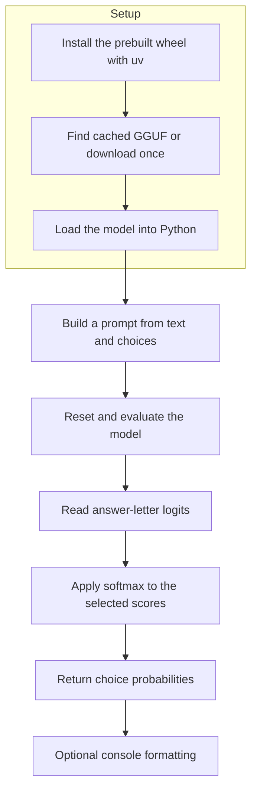

# simple-jev

A small learning project for classifying text without training. Give it choices
such as **Legitimate**, **Spam**, and **Phishing**; it returns a score for each.

Inspired by the parody article
[“Jev in 25 lines”](https://www.nobodywho.ai/posts/jev-in-25-lines/), not a
reproduction of Jev's training or calibrated decision-making.

## The basic idea

Think of this as a multiple-choice question:

```text
Email: Please send your password to verify your account.

A. Legitimate
B. Spam
C. Phishing
```

Instead of generating an explanation, we inspect the model's preference for each
answer letter. Those scores become proportions adding up to one, such as
`Legitimate: 0.03, Spam: 0.08, Phishing: 0.89` (illustrative; actual values vary).

### Reading the scores

> **0.89 is a relative preference among these choices, not an 89% chance of being
> correct.** The model must favor something even when none of the choices fit.

### Key terms

#### Input and setup

- **Prompt:** the full text given to the model, including the instruction, input,
  answer choices, and formatting that marks the conversation roles.
- **Token:** a piece of text, not necessarily a whole word. Our model represents
  each answer letter with one token; the classifier checks this assumption.
- **Context window:** the token budget for a request. Instructions, input, choices,
  and formatting all count toward it—not just the message being classified.
- **GGUF:** the model-file format containing learned weights and metadata. This
  is the `.gguf` file downloaded separately from the Python packages.
- **Wheel:** an installable Python package (`.whl`). Our runtime wheel includes
  already-compiled native code; it does not contain the Qwen model weights.

#### Scores and interpretation

- **Logit:** a raw score for a possible next token. It can be positive or negative;
  higher means more preferred, but it is not a probability.
- **Softmax:** converts scores into proportions that add up to one, with larger
  scores getting larger shares. Here it compares only our answer choices.
- **Log probability:** a probability expressed using a natural logarithm. Negative
  values are normal; they do not mean negative probabilities or errors.
- **Calibration:** whether stated probabilities match observed correctness across
  many representative examples. Predictions assigned 80% confidence should be
  correct about 80% of the time. This project does not establish that calibration.

The formulas and worked numerical examples remain beside the scoring code.

## Run your first example

### Requirements

You need [uv](https://docs.astral.sh/uv/getting-started/installation/).
The default tested setup is **macOS on Apple Silicon (ARM64), with Python 3.12**.
The project pins Python to `>=3.12,<3.13`; uv can install it if needed.

### Install and run

```sh
uv sync --extra dev
uv run simple-jev download
uv run python examples/email_classification.py
```

### Prebuilt runtime

No separate server or native compilation is needed. uv installs the pinned
`llama-cpp-python==0.3.19` **precompiled wheel** from the explicit `metal` index:
`https://abetlen.github.io/llama-cpp-python/whl/metal`. The model runs inside
Python with Metal GPU offload. `no-build-package = ["llama-cpp-python"]` prevents
source builds: platforms without a compatible wheel fail fast instead.

### Model download and cache

The default model is `Qwen/Qwen3-0.6B-GGUF`, file `Qwen3-0.6B-Q8_0.gguf`.
A fresh setup downloads roughly **639 MB**, then reuses the Hugging Face cache.
The download command takes no options and prints the cache path. It is optional:
the first model load downloads the file automatically if it isn't cached.

## Try your own text

### From Python

```python
from simple_jev import classify

scores = classify("I was charged twice.", ["Billing", "Technical support"])
print(scores)
print("Best match:", max(scores, key=scores.get))
```

### From the command line

```sh
uv run simple-jev classify --text 'I was charged twice.' --choices Billing 'Technical support'
```

### Choices and options

Supply **2–26 distinct, nonblank choices**. Letters A–Z represent the choices;
each is checked to be one token. All selected letters are scored—there is no
top-20 cutoff.

Use `instruction="..."` or CLI `--instruction '...'` to explain the task.
The default is `"Classify the input. Choose exactly one option."`. CLI options
include `--json` for the score mapping, `--model-path`, and `--n-ctx` (default
`512`). See `uv run simple-jev classify --help`.

### Reuse a model and work offline

`classify()` automatically reuses a cached model within the Python process.
To load once explicitly, as in the batch example:

```python
from simple_jev import classify, load_model

model = load_model()
scores = classify("I was charged twice.", ["Billing", "Technical support"], model=model)
```

`download_model()` returns the default file's cache path without loading it.
Both `load_model()` and `classify()` accept `model_path` and `n_ctx`. An existing
local file path bypasses Hugging Face; alternatively, set `HF_HUB_OFFLINE=1`
after caching the default file. Normal cache lookup may contact Hugging Face for
metadata, but inference is local and prompts are not sent off-device.

## Explore the examples

### Run the examples

Run all examples with quiet command output:

```sh
make -s examples
```

Or run one with `uv run python examples/email_classification.py`.

### Classification tasks

| Example | What to explore |
| --- | --- |
| `email_classification.py` | Change the email and compare category scores. |
| `sentiment.py` | Try a review with mixed opinions. |
| `ticket_routing.py` | Explain what each support team handles. |
| `language_detection.py` | Try another language or a mixed-language message. |
| `intent_detection.py` | Try unrelated or multi-intent requests. |

### Reuse, sensitivity, and the original idea

| Example | What to explore |
| --- | --- |
| `batch_classification.py` | Load one model and classify several inputs. |
| `choice_sensitivity.py` | Change answer order or wording, keeping text fixed. |
| `original_25_lines.py` | Follow the original idea's logits and softmax math. |

### Reading the output

Each result shows the input, the best match, percentage bars, raw logits, and log
probabilities normalized over the supplied choices. Colors are automatic in a
terminal and disabled when redirected. Use `NO_COLOR=1 make -s examples` for plain
text, or `FORCE_COLOR=1 make -s examples` to force color.

## Shared helpers

The shared helpers live in `src/simple_jev/helpers/`, not in the examples.

### Console output — `console.py`

`console.py` handles built-in terminal formatting without an extra dependency.
Call `show_result(..., model=model)` immediately after `classify()` to display
scores for that input, before evaluating a different input with the same model.

### Model loading — `loaders.py`

`loaders.py` handles cache-first example loading and the harmless small-context
startup message. Normal error handling remains intact.

## Read the implementation

### Setup and classification flow



### Classifier walkthrough

Start with `src/simple_jev/classifier.py`: build the Qwen3 prompt, reset and
evaluate the model, select the answer-letter logits, then apply softmax.
Comments and docstrings explain the numerical details beside the calculation.

### Original reference

`examples/original_25_lines.py` preserves the core logits math and teaching
comments, adapted to the shared model setup—not a byte-for-byte copy.
Run it like the other examples; no separate dependencies or compilation needed.

## Things to keep in mind

- **Context:** the entire prompt, including instructions, choices, and chat
  markers, must fit the default **512-token** window. Exactly filling it is
  allowed because no answer token is generated. Shorten inputs or increase
  `n_ctx` / `--n-ctx`; larger contexts and their logits buffers need more memory.
- **Compatibility:** the prompt is written for Qwen3. Other GGUFs may need
  different formatting and checks that answer letters are single tokens.
- **Privacy:** inference stays local; uncached downloads need internet access.
- **Learning, not guarantees:** wording, answer order, and instructions inside
  the input can affect results. Try an “Other” category and compare against
  answers you labeled yourself. Don't rely on these scores alone for security
  or other high-impact decisions.

## Project layout

- `src/simple_jev/classifier.py` — model loading, prompts, and scoring.
- `src/simple_jev/cli.py` — command-line entry point; `--json` stays machine-readable.
- `src/simple_jev/helpers/console.py` — shared terminal presentation.
- `src/simple_jev/helpers/loaders.py` — cache-first loading and quieter startup.
- `examples/` — eight runnable learning experiments.
- `tests/` — tests using model doubles, without model downloads.

## Development shortcuts

```sh
make test     # Model doubles; no real model needed.
make lint     # Lint and formatting checks.
make demo     # Real model; downloads it if not cached.
```

Also: `make setup`, `make download-model`, `make examples`, `make format`, and
`make check` (lint plus tests). Keep `uv.lock` for reproducible dependencies.
